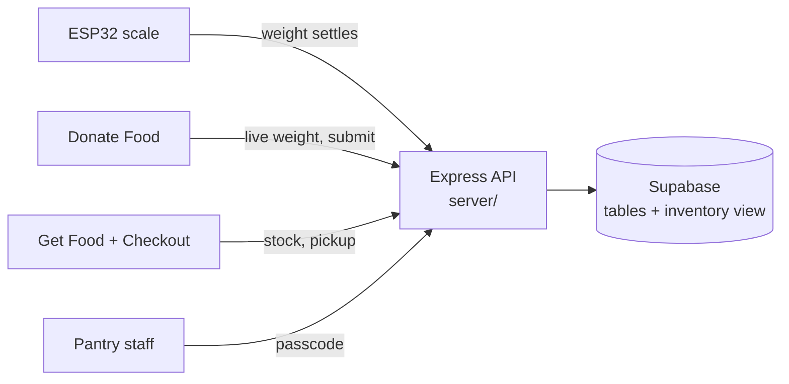

# Haxagon Food Pantry

A food pantry website designed for the CSUN Food Pantry.

- **Students** browse what's in stock and build a cart. The cart checks it covers the food groups. Then they check out for pickup.
- **Donors** place food on a Wi-Fi scale. The weight fills in by itself, and the food goes straight into stock.
- **Pantry staff** use one dashboard for pickups to hand out, stock levels, recent donations, trends and the scale's status.

Built for the Society of Software Engineers Hackathon 2026. It isn't connected to the real pantry. It runs on its own Supabase database with sample foods.

## What's done

| Feature | Status |
|---|---|
| Get Food: browse stock, cart saved in the browser (survives a refresh) | Done |
| Food-group check on the cart, "Recommend food" fills a missing group | Done |
| Checkout: pickup request, stock checked on the server, stock goes down | Done |
| Donate Food: "We're low on" list, live scale weight, multi-item donations | Done |
| ESP32 scale: sends the weight each time it settles | Done (firmware written; needs flashing and a real-hardware test) |
| Pantry staff dashboard: pickups, stock, trends, donations, scale status | Done |
| Staff can reject part of a donation (e.g. 1 dented can of 5) | Done |
| Stock can never go negative | Done |
| Recipe suggestions from the cart | Not started |
| Real staff accounts (currently one shared passcode) | Not started |

## How it works



The website and the scale only talk to the Express API. Only the API holds the Supabase key, and the database tables are locked to everything else.

### Donating with the scale
1. The donor opens Donate Food. A "We're low on" panel lists foods with 2 or fewer left. Tapping one selects it.
2. They choose a food and place it on the scale.
3. When the weight holds steady (within 3 g for 1 s), the ESP32 sends it to `POST /api/scale-reading` with the scale key.
4. The page checks for new readings every 2 s:
   - If a food is chosen, the item is added to the donation list with its weight.
   - If not, the weight waits in the form until they choose one.
   - A reading that was already there when the page opened is never added.
5. **Submit donation** saves it. Each weighed item keeps a link to its scale reading, and it counts as stock right away.

### Getting food
1. Get Food lists every food with how many are left. If the server is down, it shows example items.
2. The cart is saved in the browser (localStorage), so it survives a refresh and is shared with Checkout.
3. The food-group panel shows which groups (grains, protein, vegetables, fruits, dairy) the cart covers. It only asks for groups the pantry actually has in stock. **Recommend food** adds something from a missing group.
4. **Confirm pickup** sends the cart to `POST /api/pickups`. The server checks stock again and refuses if anything ran out, then saves the pickup and empties the cart.

### Running the pantry (staff)
"Pantry staff" at the bottom of the main menu opens `/admin`. It asks once per browser session for the passcode (`ADMIN_KEY`). The dashboard refreshes every 30 s and shows:

- **Summary tiles:** pickups waiting, items in stock, donations in the last 7 days, and foods expiring within 7 days.
- **Pickups waiting,** oldest first: **Mark picked up**, or **Cancel**, which puts the food back in stock.
- **Stock,** lowest first, labeled Out of stock, Low, Expires in N days, or OK.
- **A 14-day chart** of items donated vs picked up, with hover details and a table view.
- **Recent donations:** **Reject some** on any item (dented, opened, expired), **Change rejected**, or **Restore all**.
- **Scale status:** the last reading and whether it's active (a reading in the last 10 minutes).
- **Pickup history:** picked-up and cancelled pickups, which can be moved back to waiting.

### Stock rules
Stock comes from the `inventory` view in `supabase/schema.sql`:

> stock = items donated − items rejected by staff − items in pickups that weren't cancelled

It never shows below 0. The API also refuses anything that would oversell:
- a checkout for more than is in stock
- rejecting items that were already picked up
- reopening a cancelled pickup after its food ran out

## Project layout

| Folder | What's in it |
|---|---|
| `react/` | The website (React 19, Vite, React Router) |
| `react/src/pages/` | One file per page, plus its CSS |
| `react/src/cart.js` | The saved cart, shared by Get Food and Checkout |
| `react/src/foodGroups.js`, `FoodGroupCheck.jsx` | The food-group check |
| `server/` | Express API |
| `server/src/routes/` | One file per group of routes |
| `server/scripts/fake-scale.js` | Pretends to be the scale, for testing without hardware |
| `supabase/schema.sql` | The whole database: tables, inventory view, security |
| `supabase/seed.sql` | Demo data: 12 foods and two weeks of donations and pickups |
| `firmware/scale_station/` | ESP32 scale firmware (Wi-Fi + sends readings) |
| `firmware/scale_test/` | Bench test and calibration sketch for the scale |
| `hardware/` | OpenSCAD source and STL files for the 3D-printed scale plate |

## Getting started

**Prerequisites:** [Node.js](https://nodejs.org/) 22+ and npm, plus a Supabase project.

### 1. Database
In the Supabase SQL Editor, run these two files in order. Both are safe to run again.

1. `supabase/schema.sql`
2. `supabase/seed.sql` (demo data: 12 foods, two weeks of donations and pickups, 2 pickups waiting)

To change the schema later, edit `schema.sql`, then run just the new statement by hand (for example `alter table ... add column if not exists ...`). That keeps the file the one source of truth.

### 2. Server
Create `server/.env`:

```bash
SUPABASE_URL=https://<project>.supabase.co
SUPABASE_SECRET_KEY=<service role key>   # server only, never in the browser or the ESP32
SCALE_API_KEY=<any long random string>   # the ESP32 sends this; must match its secrets.h
ADMIN_KEY=<staff passcode>               # typed in on the Pantry staff page
```

```bash
cd server
npm install
npm run dev        # API on http://localhost:3000, restarts on save
```

`GET http://localhost:3000/api/health` should return `{"ok":true,"database":"connected"}`.

### 3. Website
```bash
cd react
npm install
npm run dev        # http://localhost:5173
```

The website looks for the API at `http://localhost:3000`. To change that, copy `react/.env.example` to `react/.env` and set `VITE_API_URL`.

Other scripts (from `react/`): `npm run build` (production build), `npm run preview` (serve that build), `npm run lint` (oxlint).

### 4. Scale (optional)
1. Copy `firmware/scale_station/secrets.example.h` to `secrets.h`. That file is gitignored.
2. Fill in:
   - **Wi-Fi:** a 2.4 GHz phone hotspot.
   - **Server address:** your laptop's IP on that hotspot.
   - **`SCALE_API_KEY`:** the same value as in `server/.env`.
3. Flash `scale_station.ino` to the ESP32. It needs the HX711 (Bogdan Necula) and Adafruit SSD1306 libraries.
4. Calibrate it with the `firmware/scale_test` sketch first. Wiring is in [Scale hardware](#scale-hardware) below.

### Testing without the scale
With the server running, `npm run fake-scale` (from `server/`) sends readings exactly as the ESP32 does. Type a weight and press Enter, or pass several at once: `npm run fake-scale -- 412 250 800`. Keep Donate Food open to watch them arrive.

## Pages

| Page | Route | What it does |
|---|---|---|
| Main Menu | `/` | Get Food or Donate Food, plus a small "Pantry staff" link |
| Get Food | `/get-food` | Stock, saved cart, food-group check, Recommend food |
| Checkout | `/checkout` | Review the cart, name and email, confirm pickup |
| Donate Food | `/donate-food` | "We're low on", live scale weight, donation list, submit |
| Pantry staff | `/admin` | Staff dashboard (passcode) |

## API

| Method | Route | Used by |
|---|---|---|
| GET | `/api/health` | Checking the server can reach the database |
| GET | `/api/inventory` | Get Food, Checkout, Donate Food, Pantry staff |
| POST | `/api/pickups` | Checkout |
| POST | `/api/donations` | Donate Food |
| POST | `/api/scale-reading` | The ESP32, with header `x-scale-key` |
| GET | `/api/scale-reading/latest?station=intake-1` | Donate Food (live weight) |
| GET | `/api/admin/check`, `pickups`, `donations`, `trends`, `scale-readings` | Pantry staff, with header `x-admin-key` |
| PATCH | `/api/admin/pickups/:id`, `donation-items/:id` | Pantry staff: pickup status, rejected count |

## Scale hardware

ESP32 (Arduino C++), HX711 amplifier with a 10 kg bar load cell, 0.96" SSD1306 I2C OLED, a button, a buzzer and an LED.

**Wiring**

| Part | Connection |
|------|------------|
| Load cell red / black / green / white | HX711 E+ / E− / A+ / A− |
| HX711 VCC / GND | 3.3V / GND |
| HX711 DT / SCK | GPIO 16 / GPIO 4 |
| OLED VCC / GND | 3.3V / GND |
| OLED SDA / SCL | GPIO 21 / GPIO 22 |
| Button | GPIO 13 + GND (`INPUT_PULLUP`) |
| Buzzer | GPIO 25 / GND |
| LED | GPIO 26 → 220 Ω resistor → LED → GND |

On the scale: tap the button to tare, hold it 2 s to switch between raw counts and grams. Two short beeps mean a reading was saved; one long beep means it wasn't sent. The Serial Monitor (115200 baud) takes `t` (tare), `c 500` (calibrate with a known 500 g item), `r`, `b` and `s` (send the current weight).

**3D-printed plate:** `hardware/scale_plate.scad` is a parametric OpenSCAD plate (150 × 150 × 6 mm with a 5 mm spacer pad, 5.5 mm bolt holes and 10.5 × 3 mm head recesses). Its `variant` parameter produces two parts. Print one of each in PLA on a Prusa MK4 with the pad facing up and no supports.
- `scale_plate_bottom.stl` sits pad-up on the table and bolts to the **cable end** of the load cell (the fixed end). Its underside has a "FRONT" arrow and an assembly note.
- `scale_plate_top.stl` is flipped end to end and bolts to the other end (the free end, which takes the load). The bar's printed arrow points down.
- Both plates have 5.5 mm holes, so use whichever bolt fits each end's threads: M4x20 + washer or M5x20.
- The top plate's flat face is the food surface, debossed with the Haxagon logo. The load cell was measured with calipers: 80 × 13 × 13 mm, holes 4.75 mm from the end and 15 mm apart.

## Team

| Person | Area |
|--------|------|
| Daniel | Database |
| Hanna | Frontend |
| Andrew | Hardware (`hardware/`, `firmware/`) |
| Jose | Backend |
| Evan | QA testing |
| Justin | Frontend and backend |

Work on a branch and merge to `main` through a pull request.
